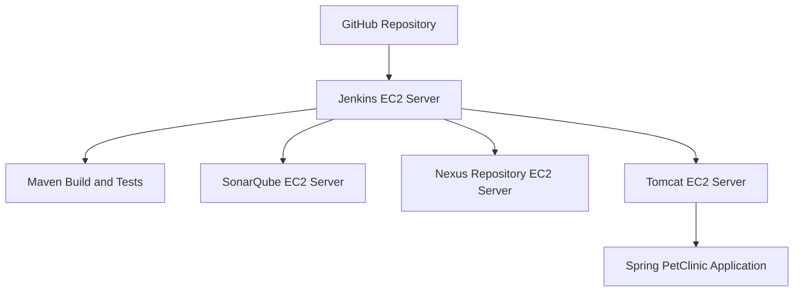

# Spring PetClinic CI/CD Pipeline

## Project Overview

This project demonstrates the automation of the software build, code analysis, artifact management, and deployment lifecycle using Jenkins and DevOps tools.

The pipeline builds and tests the Spring PetClinic application, analyzes code quality with SonarQube, publishes the WAR artifact to Nexus Repository Manager, and deploys the application to Apache Tomcat hosted on AWS EC2.

## Technologies Used

- **Cloud:** AWS EC2
- **CI/CD:** Jenkins
- **Version Control:** Git and GitHub
- **Build Automation:** Maven
- **Code Quality:** SonarQube
- **Artifact Management:** Nexus Repository Manager
- **Application Server:** Apache Tomcat
- **Operating System:** Linux
- **Remote Deployment:** SSH and SCP

## Infrastructure and Deployment Architecture

This project uses a multi-server architecture on AWS EC2. Four separate EC2 instances were provisioned, each dedicated to a specific DevOps tool or application service. These servers were integrated through Jenkins to implement the CI/CD workflow.

### Dedicated EC2 Instances

| Server | Purpose |
|---|---|
| **Jenkins Server** | Orchestrates the CI/CD pipeline and coordinates the build, analysis, artifact upload, and deployment stages. |
| **SonarQube Server** | Performs static code analysis and code quality assessment. |
| **Nexus Repository Server** | Stores and manages generated WAR artifacts. |
| **Apache Tomcat Server** | Hosts the deployed Spring PetClinic application. |

### Architecture Diagram

### Infrastructure Highlights

- Provisioned four separate AWS EC2 instances for Jenkins, SonarQube, Nexus Repository Manager, and Apache Tomcat.
- Integrated the DevOps services into a centralized Jenkins CI/CD pipeline.
- Configured inter-server communication and SSH/SCP-based remote deployment.
- Separated code quality analysis, artifact management, pipeline orchestration, and application hosting across dedicated servers.

## CI/CD Workflow

1. **Git Checkout:** Jenkins retrieves source code from GitHub.
2. **Build and Test:** Maven compiles the application, runs automated tests, and packages the WAR file.
3. **Code Analysis:** SonarQube performs static code analysis.
4. **Artifact Upload:** Nexus stores the generated WAR artifact.
5. **Deployment:** Jenkins transfers the WAR file to the Tomcat server on AWS EC2.

## Validation Results

- A verified Jenkins build completed the Git checkout, Maven packaging, SonarQube analysis, and Nexus artifact upload stages successfully.
- Maven executed **62 tests with zero failures or errors**.
- The WAR artifact was uploaded to Nexus Repository Manager.
- The deployment stage was configured to connect to the Tomcat server.

**Note:** Confirm a successful end-to-end deployment before claiming that every stage completed successfully. The latest recorded Jenkins log showed a missing `tomcat` SSH credential during deployment.

## Key Learning Outcomes

- Jenkins pipeline configuration and stage orchestration
- Maven build and test automation
- SonarQube integration for code quality analysis
- Nexus artifact repository integration
- AWS EC2 provisioning and multi-server configuration
- Linux server administration and inter-server communication
- SSH/SCP-based remote deployment

## Source Application

Spring PetClinic: https://github.com/spring-projects/spring-petclinic

## Security

Credentials, private SSH keys, access tokens, passwords, and sensitive environment configuration should be maintained outside the repository. Use Jenkins Credentials to manage sensitive values securely.
